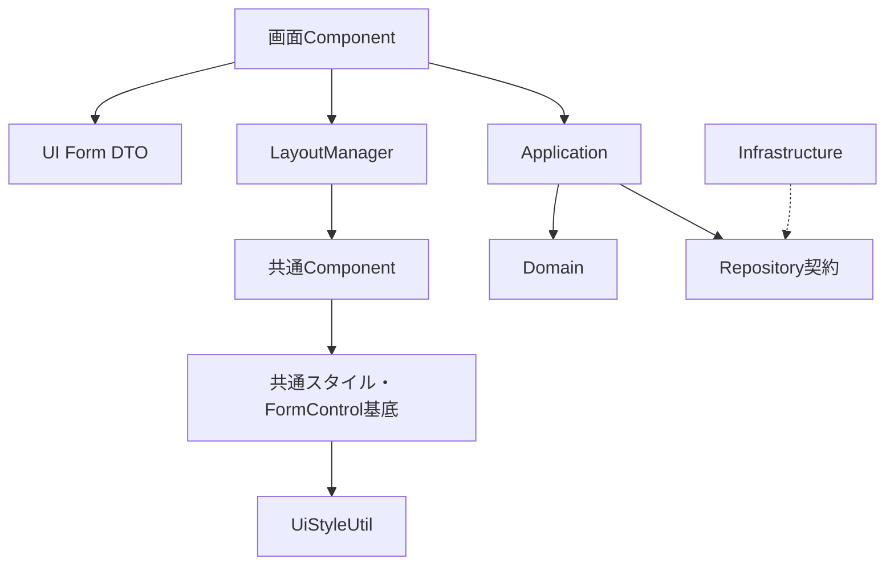

# アーキテクチャ・責務境界 詳細設計

## ARC-01 目的と範囲

画面設計書からAIが、既存LayoutManager・共通Component・ACGを使って画面を実装する。人間が構造を読み理解・変更できることを到達点とする。画面独自CSS、無断の共通Component増設、生成ソースの直接修正で不足を迂回しない。AIモデル自体の開発基盤ではない。

対象はAngular＋CapacitorのAndroid/iPhone。Tailwind CSS・DaisyUIを基礎とする。テニスのサーブ順・リターン側、個別Domain API、RESTエンドポイント、SQLiteトランザクションの新設はアプリ固有の別設計とし、フレームワークの未決へ戻さない。

## ARC-02 構造と依存

Layout→UIは配置関係。親のFormControlを子へ渡し、子が別のFormControlを複製しない。

| 層 | 保有・実行するもの | 持たせないもの |
|---|---|---|
| 画面 | 入力DTOのinject、表示DTO配列、表示条件、イベント、値DTO変換、Application呼出し | SQL、DAO直呼出し、共通内部DOM/CSS、業務判定の重複 |
| UI Form DTO | 型付きFormGroup、FormControl、初期値、初期disabled、入力Validator | DB、Application、画面遷移、業務メソッド |
| 表示DTO | readonlyプロパティの1行分の値 | FormControl、DI、業務メソッド |
| Layout | 外側幅・gap・順序・行分割・再配分 | 入力値、disabled判断、ラベル、保存 |
| 共通UI | 内部描画・必要幅・入力接続・汎用通知 | 画面固有Application、Domain、DB |
| Application | ユースケース順序、Domain・Repositoryの調整、値DTO | FormGroup、FormControl、CSS |
| Domain | 業務上の意味・不変条件・状態遷移 | Angular、SQLite、REST、UI |
| Infrastructure | Repository実装、DB、REST、端末I/O | UI判断、業務規則の肩代わり |

## ARC-03 配置

パスはアプリリポジトリからの相対パス。既存コードの一括移設を目的にしない。

| 実装対象 | 配置 |
|---|---|
| ComponentBase | `src/app/brf9000/brf9020-shared-components/component-base/component/component-base.ts` |
| FormControlComponentBase | 同ディレクトリの`form-control.component-base.ts` |
| スタイル型 | `brf9020-shared-components/component-base/ui-style.types.ts` |
| UiStyleUtil | `src/app/brf9000/brf9017-utils/ui-style.util.ts` |
| LayoutMetricsService | `brf9020-shared-components/layout/layout-metrics.service.ts` |
| LayoutMeasureUtil・LayoutRowUtil | 同`layout-measure.util.ts`・`layout-row.util.ts` |
| LabelComponent | `brf9020-shared-components/label/components/label.component.{ts,html,scss}` |
| TextOverflowController | `brf9020-shared-components/text/text-overflow.controller.ts` |
| 通常UI | 既存の`{alert,button,date,fab,group,radio,textbox,toggle}/components/` |
| Table・Swipe・Layout | 既存の`table/`、`swipe/`、`layout/` |
| Header・TabBar・AppLayout | 既存`src/app/brf8000/brf8010/ui/components/` |
| AppUiColorEnum | 文書`06_列挙型設計書/02_COMPONENT/`→生成先`brf9011-enum/component/` |
| 文字表示Enum | 現行文書`06_列挙型設計書/01_CODE/`→生成先`brf9011-enum/code/` |
| 静的検査 | `tools/bruce-layout/`（Node ESM） |
| ビルド入口 | `tools/bruce-build.mjs`・`package.json` |
| CI | アプリ側`.github/workflows/bruce-build.yml`。文書側にAngular CIを追加しない |

内部ファイル名は今回の実装設計。画面向け自由設定APIではない。Labelは承認された文字表示部品を具体化する。調査時点のソースには独立したLabelComponentが存在しない。

## ARC-04 データとイベント

1. 画面が`providers: [XxxDto]`を登録し、`readonly dto = inject(XxxDto)`で取得する。rootシングルトンと`new XxxDto()`を採用しない。
2. HTMLで`@let ctrls = dto.formGroup.controls;`を定義し、`[control]="ctrls.name"`で同じインスタンスを接続する。TSに記述短縮専用の`controls`を置かない。
3. 子の入力はFormControlのvalue・dirty・touchedを更新する。OutputのeventKeyは操作の識別子であり、フォーム値とは別の型とする。
4. 画面がForm状態を確認し、必要値だけApplication DTOへ明示変換する。disabled項目は`FormGroup.value`から省略されるため、必要項目を個別controlまたは`getRawValue()`から取得する。
5. Application結果は画面で変換し、privateな`applyingResult`カウンターを加算→try内で`patchValue(...,{emitEvent:true})`→finallyで減算する。画面の自動保存購読は通知の受信時点で`applyingResult===0`をfilterし、その後にdebounce等を適用する。これにより子の表示同期へ通知し、ロードの再保存だけを抑止する。接続済みcontrolへのsilentな値更新は使用しない。自動保存の採否・待機時間はアプリ固有。
6. 入力異常はForm状態、業務異常・保存成否・通信異常はApplication契約に従い画面が扱う。共通Button・Textboxが保存を再試行しない。

## ARC-05 ライフサイクルと余白

画面破棄時に画面スコープDTOとForm状態を破棄する。再表示時に以前の画面インスタンスのFormGroupを共有しない。入力基底は接続したcontrolの購読を解除する。幅計測・文字移動・Table・Swipeは、Observer・イベント・requestAnimationFrame・Animation・bodyへ追加したDOMを所有者が破棄する。

横gapはLayoutItem、縦gapはItemStackLayout、内部paddingは各部品、画面外周paddingは上位Containerが担当する。新しいScreenLayout・gapSize・minWidth・responsiveBreakpointを画面向けに先行追加しない。仕様のない寸法をAI判断で補わない。

## ARC-06 異常と検証

入力部品の必須control未指定は構成エラー。ダミーcontrolを作らない。無効Enum・スタイル値を黙って正常値へ補正しない。Layoutの静的規則はビルド前検査、動的配分はLayout、業務異常はApplication/Domain、表示品質は部品・両OS試験で検証する。

テスト：T-ARC-01〜04、T-FORM-01〜08、各部品の破棄試験。承認済み方式で進められない場合は04章の安全停止と再開記録を適用する。

根拠：Phase 2.1・2.6・2.7、Phase 3.3・3.6の2026-10-20最終承認。原典位置は16・31章に記録する。17章は過去の移行監査索引であり現行根拠に戻らない。
