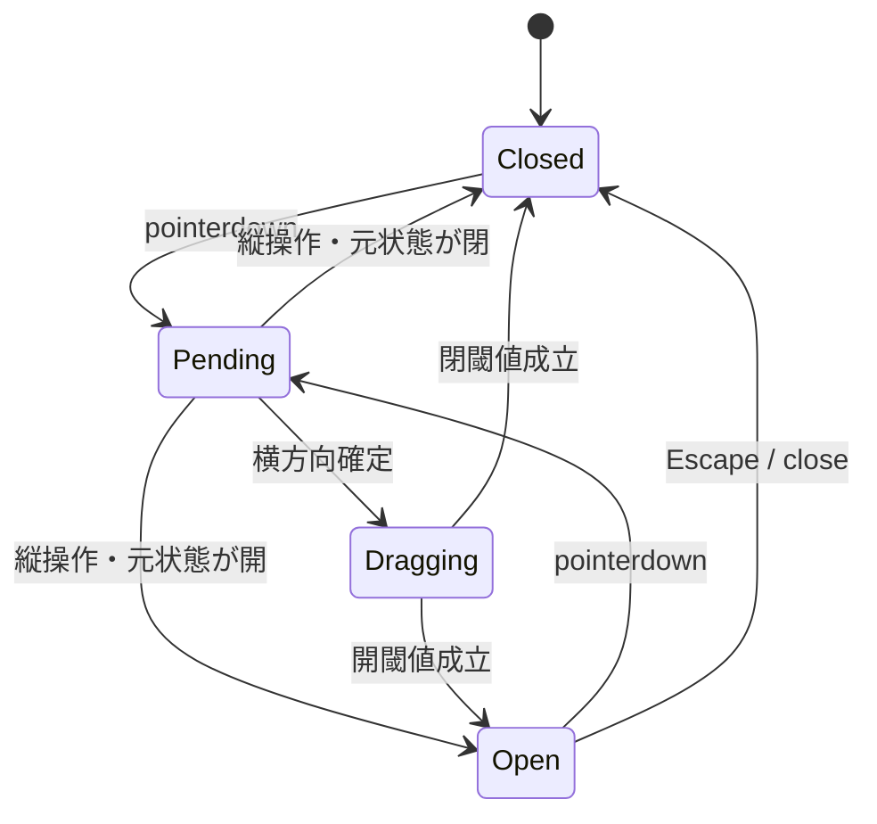

# Table・角丸描画・Swipe 詳細設計

## TABLE-01 構造と責務

```html
<app-table-container-layout [columns]="100" [responsive]="true">
  <app-table-record [clickable]="true" (recordClick)="selectRow()">
    <app-table-row>
      <app-table-cell [colSpan]="35" [backgroundColor]="uiColor.BASE_200">項目</app-table-cell>
      <app-table-cell [colSpan]="65">値</app-table-cell>
    </app-table-row>
  </app-table-record>
</app-table-container-layout>
```

table→colgroup/Record→tbody→Row→tr→Cell→td/thの実体構造を維持する。Record/Row/Cellのホストはdisplay:contents。colSpan/rowSpanと角丸はDOM順推測で置き換えない。ViewEncapsulation.Noneのセレクターは`app-table-container-layout`等の接頭辞で範囲を限定し、別テーブルへ漏らさない。

ComponentBaseをTableContainer/Record/Cellが利用する。Rowは構造・sticky責務を維持し、今回共通スタイルInputの追加対象へ含めない。Rowの条件付き除去は画面の@ifで行う。共通Signal Inputは基底一箇所、固有Inputは各Componentのみで定義する。

## TABLE-02 全公開API

既存の固有Input名を保持する。新しい共通Inputは02章。旧decorator InputをSignalへ変更する場合はHTML参照にも()を反映し、混在させない。

| 対象 | プロパティ | 型/既定値 | 意味 |
|---|---|---|---|
| Container | columns | numberまたはstring、100 | 論理列数。現行互換でNumber→floor、正の有限数以外は100 |
| Container | logicalColumns | readonly unknown[] | columns個のcolを生成 |
| Container | zebra | boolean=false | Record単位交互背景 |
| Container | responsive | boolean=false | 内部横スクロールとmin-w-max |
| Container | empty | boolean=false | 空データ表示 |
| Container | emptyMessage | string='' | キーなし時の本文 |
| Container | emptyMessageKey | メッセージキーまたはundefined | i18n優先 |
| Container | recordGap | number=0 | Record間px。先頭にスペーサーなし |
| Container | recordShadow | boolean=false | 既存Record装飾影。共通shadowとは別 |
| Record | clickable | boolean=false | クリック通知するか |
| Record | selected | boolean=false | 選択色・aria-selected |
| Record | cellBorder | boolean=false | 既存のセル一括罫線 |
| Record | recordClick | Output<void> | clickable時のみ1回emit |
| Record | tableLayout | Container参照 | 祖先ContainerをDI。存在しなければ構成エラー |
| Row | sticky | boolean=false | 上端固定 |
| Cell | colSpan | number=1 | 論理列結合 |
| Cell | rowSpan | number=1 | 行結合 |
| Cell | header | boolean=false | true=th、false=td |
| Cell | sticky | boolean=false | 左端固定 |
| Cell | align | AppComponentTableCellAlignEnum=LEFT | text-align |
| Cell | verticalAlign | AppComponentTableCellVerticalAlignEnum=MIDDLE | vertical-align |
| Cell | radiusPosition | AppComponentTableCellRadiusPositionEnum=NONE | none/left/right/四隅/all |
| Cell | backgroundColor/textColor | AppUiColorEnumまたはundefined | 共通基底から継承 |

columnsの既存補正仕様をLayoutSpanにも流用しない。columnsは別の公開契約。colSpan/rowSpanは正の整数を要求し、不正ならBRUCE_TABLE_SPANをthrowする。既存の正常値は変えない。recordGapの負数/非有限値は構成エラー。emptyMessageKeyがあれば本文より優先する。

## TABLE-03 色伝播の正確な計算

Cellの実効色は、各属性ごとに次式で決める。

```ts
cellExplicit ?? recordExplicit ?? tableExplicit ?? cellDefault
```

**親の実効値に親の既定色を混ぜて伝播しない。** Record/Tableの明示Inputを参照する。CellはRecordとContainerをoptional ancestor DIで取得する。Recordは自身の必須Containerを使う。近い別テーブルの色を越えて探索しない。

| 属性 | 伝播 |
|---|---|
| backgroundColor・textColor | Table→Record→Cell。未指定undefinedは次候補 |
| border・borderWidth・rounded・roundedSize・shadow・shadowSize・padding | 伝播しない。指定Componentの実体だけ |
| visible | 各部品自身の表示。親が非表示ならDOMとして子も非表示 |
| zebra・selected・sticky・cellBorder・recordShadow | Table固有表示。共通Input継承とは別 |

Container/Recordの色指定はCellの既定指定として伝播し、同じ色を下地へ二重に塗って20%背景を不透明にしない。通常データ領域はCellが実際に塗る。空表示用tdにはContainerの色を同じルールで適用する。スペーサーは透明を維持する。

AppUiColorEnumのERROR/INFO/WARNING/SUCCESSはCellで20%背景。一般UIでは通常色。undefinedは追加背景なし。旧専用EnumのDEFAULT→undefined、LABEL→BASE_200、4状態値→同名共通色へ移行する。旧Enumと共通Enumの二重Inputは作らない。旧設計書は履歴表示してACGの現行生成対象から除外する。

## TABLE-04 CSS優先順位と固定

背景の優先順位は、Cell/Record/Tableの明示色解決→Cell既定→状態のフォールバック。selectedはRecordの下地primary/text-primary-content、zebraは未選択Recordのbase-200、通常は既存テーマ。Cellに明示色がある場合はその色を維持する。透明20%色と選択下地の混色は現行表示との比較で検証する。色指定でselectedフラグ自体を変更しない。

stickyセル/行の不透明な下地は、selected Recordならprimary、未選択zebraの対象Recordならbase-200、その他base-100。明示背景Enumが通常の不透明色ならその色を使う。明示状態色20%は同じ不透明下地の上に20%色を重ね、スクロールした他行を透けさせない。明示色をbg-base-100が無条件上書きしない。状態色とstickyの合成は固定CSSで定義する。例stickyかつbg-error/20ならbackground-image:linear-gradient(color-mix(in oklab,var(--color-error) 20%,transparent),color-mix(in oklab,var(--color-error) 20%,transparent))、background-colorは上記下地。INFO/WARNING/SUCCESSも4通りを静的記述し、既存の20%という割合を変えない。非stickyは従来の20%背景を維持する。

重なり順：通常0、左固定10、上固定20、両方の交点25、角丸オーバーレイ30、Swipe40。交点判定はCell.stickyと祖先Row.stickyの組合せ。

罫線はCellの明示border/widthがある場合にそれを最優先し、なければRecord.cellBorderによる1px base-300を使用する。セル一括罫線と個別のborder=falseを両立するため、従来の無条件!importantセレクターを、明示なしセルだけへ限定する。新しい任意class Inputは追加しない。

Cell paddingは未指定なら現行0.125rem/0.25rem。明示paddingは02章の全方向指定。rounded=falseの明示指定は角丸補正を無効にする。未指定時は既存radiusPositionを使い、NONEなら角丸なし。roundedSize明示時はその値、未指定時は既存--app-table-radius=0.5remを使う。Table/Recordのrounded・shadowをCellへコピーしない。

## TABLE-05 HTML/CSSの実装骨格

```html
<!-- Container -->
<div class="app-table-layout-wrapper" [class.overflow-x-auto]="responsive">
  <table class="table table-fixed w-full app-table-layout" appTableCorners
    [class.app-table-layout--zebra]="zebra" [class.min-w-max]="responsive"
    [style.--app-table-record-gap.px]="recordGap">
    <colgroup>@for (column of logicalColumns; track $index) { <col /> }</colgroup>
    @if (empty) {
      <tbody><tr><td [attr.colspan]="logicalColumns.length">{{ resolvedEmptyMessage() }}</td></tr></tbody>
    } @else { <ng-content /> }
  </table>
</div>
```

RecordはrecordGap>0でaria-hiddenのspacer tbodyを直前に作り、先頭RecordのスペーサーをCSSでdisplay:none。データtbodyへaria-selectedとclick handlerを設定する。onClick():voidはclickable=true時のみrecordClick.emit()。Swipeのcapture抑止後はこのhandlerまで届かない。

Rowはtrへ上固定クラスを適用する。Cellは一つの投影templateを用意し、headerによりth/tdを排他的に作る。colspan/rowspan、align.value、verticalAlign.value、data-table-radiusを設定する。ホストのclassNameは一切読み取らず、内部td/thのclassへ転送しない。

```css
app-table-container-layout .app-table-layout { border-collapse:collapse; border-spacing:0; border-radius:0; }
app-table-container-layout .app-table-layout-wrapper { position:relative; isolation:isolate; }
app-table-container-layout .app-table-record-spacer > td { padding:0!important; border:0!important; background:transparent!important; }
app-table-container-layout .app-table-corner-overlay { position:absolute; pointer-events:none; z-index:30; }
```

色・角丸・影のclassは02章の固定変換だけを使用する。外部`class`を別名APIで復活させない。

## TABLE-06 TableCornersDirectiveと幾何計算

`table[appTableCorners]`に付与。Input/Outputなし。初回描画後、tableの親wrapperにSVG、clipPath、arc描画、影レイヤー、非表示のradius測定要素を各1個作る。IDは同一documentで一意とし、複数テーブルで共有しない。

| メンバー/メソッド | 型/契約 |
|---|---|
| table | HTMLTableElement、DIで取得 |
| overlay/clip/arcs/shadowLayer/radiusProbe | private DOM参照、初期化前undefined |
| observedCells | Set<HTMLTableCellElement> |
| resize/mutations/frame/destroyed | Observer、rAF番号、破棄フラグ |
| initialize()→void | DOM生成→Observer登録→update |
| schedule()→void | rAFを1個に集約 |
| update()→void | 実体セル収集→座標補正→clip/arc更新→影更新 |
| updateRecordShadows()→void | スペーサー除外、各Recordに必要な影だけを生成 |
| ngOnDestroy()→void | 全監視解除、追加DOM除去、tableのclip-path解除 |

監視対象はResizeObserver(table、radiusProbe、各実体cell)、MutationObserver(childList/subtree/文字とrowspan/colspan/class/style/data-table-radius)、capture scroll、window resize。削除されたcellはunobserveする。rAF内で計測と描画をまとめ、同じ値を書き続けない。

`tableGridOffset(tableRect, groupRects):{x:number,y:number}`：幅・高さ>0のtbody矩形の左L/上T/右R/下Bを取得。x=table.x+(table.width−(R−L))/2−L、yも同様。対象なしは0/0。UA名でBlink/WebKitを分岐しない。

`tableCornerGeometry(width,height,cells,requestedRadius)`はDOMなしの純粋関数。各cellはx/y/width/height/radiusPosition/borderedを持つ。基準半径r=max(0,min(requestedRadius,cell.width/2,cell.height/2))。四隅の原点は(x,y)、(x+w,y)、(x,y+h)、(x+w,y+h)。left/rightは該当する上下2隅、allは4隅を選ぶ。r=0/NONEは追加clipなし。全体矩形pathへ四隅の除去pathを追加し、evenoddで抜く。罫線ありは内側半径max(0,r−borderWidth/2)、SVGで外側の弧を描画する。Cell別の半径・罫線幅は追加の内部測定値として保持し、弧を同じstroke-widthごとに分けて描く。1px固定の旧計算を4px指定へそのまま適用しない。

clip-pathは同一documentの絶対URL＋clipIDとする。base href/深いルートで壊さない。半径NONEしかなければclip-pathを空にする。SVGはaria-hidden/focusable=false、背景を不透明パッチで隠さない。rowspan/colspanの実際の結合結果はブラウザーの矩形から取得する。

Recordの影は実体tbody矩形に合わせる。Container.recordShadowは従来のレコード装飾として扱い、Record.shadow明示があれば当該Recordの指定を優先、未指定なら既存装飾を利用する。Tableの共通shadowをRecordへ継承しない。同一Recordへ影を二重描画しない。Record.shadow=falseでそのRecordだけ無効にできる。影レイヤーはpointer-events:none。

## SWIPE-01 公開契約と名称

原典の「SwipeComponent」は独立した操作部品という責務名。現行実装は`SwipeDirective`であり、本書では既存Directiveを維持する。新しいComponentラッパーへの置換承認を捏造しない。

| API | 型/契約 |
|---|---|
| selector/exportAs | [appSwipe] / swipe |
| appSwipe | Nullable<TemplateRef<SwipeContext>>、既定null |
| SwipeContext | close:()=>void |
| swipeOpenChange | Output<boolean>、状態が変化した場合だけ通知 |
| isOpen | readonly boolean |
| open()→void | geometry更新、panel幅>0、coordinator確保後に開く |
| close()→void | gesture取消、閉じる、coordinator解放 |
| ngOnChanges()→void | template変更時は旧view/portalを破棄して再構築 |
| ngOnDestroy()→void | 全監視・DOM・view・capture・rAFを破棄 |

スタイル適用はアクションパネル部分。gestureをComponentBase/Layoutへ移さない。ComponentBase継承を一律強制しない。TableContainerがproviders:[SwipeCoordinator]を持ち、テーブルごとに排他。単独カードはcoordinatorなしで利用可能。

## SWIPE-02 内部状態・処理

private状態：host、document/window、view、overlay、panel、Resize/MutationObserver、observed要素Set、initialized/destroyed、frame、width、offset、opened、suppressClickUntil、previousFocus、gesture{id,x,y,startOffset,wasOpen,axis}。axis=pending/horizontal/vertical。

| イベント/メソッド | 処理 |
|---|---|
| rebuild | gesture取消→close→旧view破棄→portal除去→templateがあればbodyへ再作成 |
| pointerDown(e) | primary/左button/他gestureなし/panel幅>0を確認、開始座標とoffsetを保存 |
| pointerMove(e) | 8px未満は保留。abs(dx)>abs(dy)×1.25なら横、逆なら縦。曖昧なら保留 |
| 横移動 | cancelable時preventDefault、hostへcaptureを試み、offset=clamp(startOffset−dx,0,width) |
| pointerUp(e) | 最終座標も反映。閾値min(48,width/2)。閉状態からdistance>=閾値でopen、開状態からdistance>−閾値ならopen維持 |
| pointerCancel/lostCapture | 元のwasOpenへ戻す。子からhostへのcapture移譲をcancelと誤認しない |
| settle(open) | coordinator確保/解放→フォーカス保存/復元→offset→render→状態変更時のみ通知 |
| click capture | Swipe後700msのpointer由来clickを抑止。開状態の元内容タップは閉じてrecordClickを止める |
| keyDown | Escapeで閉じる。keyboard由来click(detail=0)を700ms抑止に巻き込まない |

数値8/1.25/48/700/180msは現行ソースの互換値として記録した。新たなタップ最小寸法ではない。



## SWIPE-03 Portal・geometry・アクセシビリティ

元table DOMとclip-pathを変更しない。body直下のfixed overlayにabsolute panelを置き、hostがdisplay:contentsならスペーサーを除く子矩形のunionを使う。scroll祖先のclient領域とviewportの共通矩形でclipする。幅はmin(host幅,panel実測幅)。geometry変更は180msアニメーションを使わずsnapし、通常開閉だけ既存transitionを使う。

panelは閉状態・drag中にinert=true、aria-hidden=true、pointer-events:none。開いて静止した時だけ操作可能にする。close時にpanel内にフォーカスがあれば前の接続済み要素へpreventScrollで復元する。reduced-motionではtransitionを無効にする。開くボタンからopen()を利用でき、スワイプのみを唯一の手段にしない。

root/hostのテーマCSS変数・font/color/directionをportalへ反映する。テーマ変更を監視し、開いたままでも再コピーする。Geometry監視はResize/MutationObserver、capture scroll、resize、visualViewport resize/scroll。毎イベントの同期全再計測を避けrAFへ集約する。

## SWIPE-04 SwipeCoordinator

@Injectable()、root提供なし。private active:SwipeActionsOwnerまたはundefined。SwipeActionsOwnerはclose():voidだけを持つ。

claim(owner):booleanは同じownerならtrue。旧activeを退避→新ownerをactiveへ設定→旧owner.close()→active===ownerを返す。close通知中に別ownerが開く再入を考慮する。release(owner):voidはactive===ownerの場合だけundefinedへ戻す。別テーブルのcoordinatorへ干渉しない。

## SWIPE-05 既知の競合・異常・テスト

touch-action:pan-y pinch-zoomの現行方式は縦scroll/zoomを維持するが、responsive Tableの横scrollとの競合が既知。**どちらを優先するかは原典で未決であり、単なる実機試験済みとして閉じない。** 18章U-02に選択肢と実装影響を記載する。承認前にジェスチャー対象や横scrollを無断で削除しない。

template=nullはportalなし、panel幅0/非表示は開かない、破棄後の予約callbackは何もしない。pointer capture失敗時もdocumentリスナーで継続し、無限例外を出さない。document/windowのない環境ではafterNextRenderのDOM処理を起動しない。

テスト：T-TABLE-01〜14、T-SWIPE-01〜12。U-02未解決の複合横操作について実装可能性監査は保留。その他は既存正常系を維持する設計である。

## TABLE-07 keyboard操作の利用側契約

Record.clickableによるtbodyクリックだけを、keyboard利用者の唯一の選択手段にしない。利用画面は同じ選択/詳細処理を呼ぶ既存Button等をCellへ投影する。Buttonのclick/Enter/Spaceが同じ画面handlerへ到達することをT-DEVICE-03/08で検証する。tbodyへbutton roleを付けてtableの行構造を壊したり、共通基盤からアプリ固有の列・選択文言を勝手に追加したりしない。Swipeも既存open()/close()を呼ぶ利用側の操作経路を持つ。英語固定Actionsは現行互換値として保持するが、多言語ラベルの正式APIは原典未決であり実装済みとしない。
