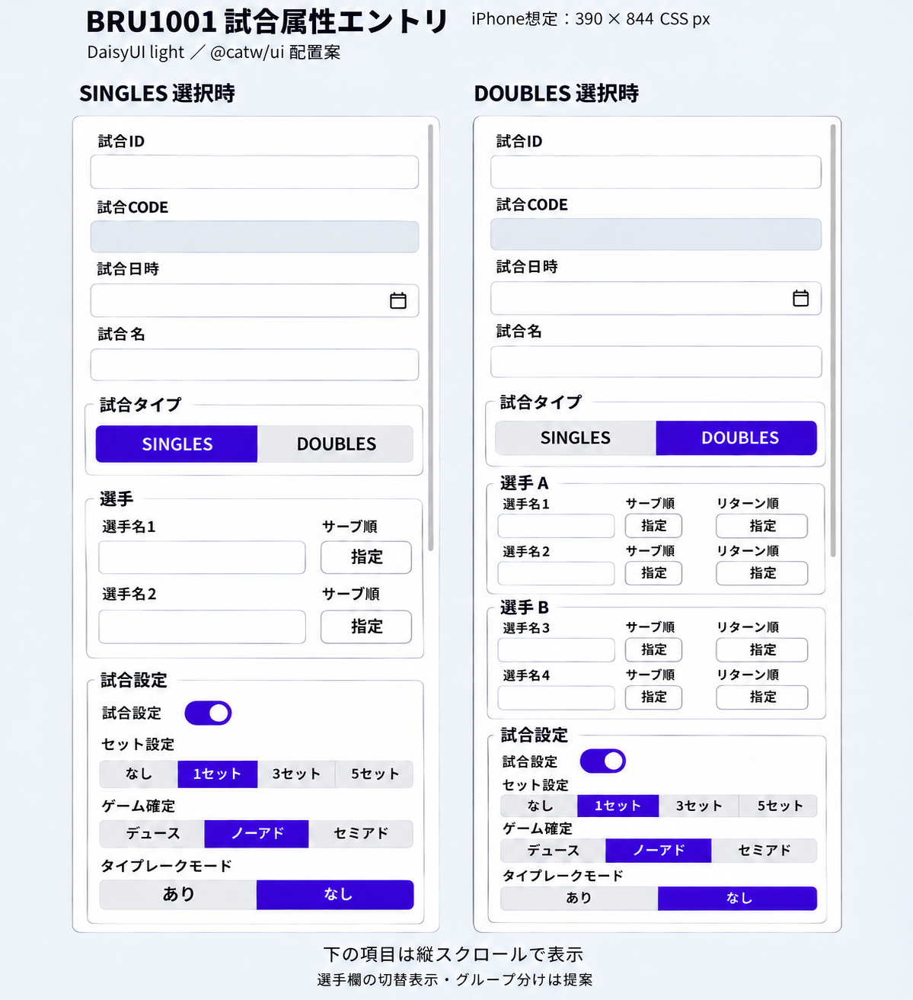

# 画面設計書
- 論理名：試合属性エントリ
- 物理名：Bru1001Component
- ファイル名：bru1001.component.ts

## １．概要
試合属性の新規登録、更新をおこなう。

## ２．画面イメージ

iPhoneの縦向き表示（390 × 844 CSS px）を想定した、DaisyUIの`light`テーマ・`@catw/ui`による配置イメージ。左はSINGLES選択時、右はDOUBLES選択時を示す。

サーブ順・リターン順ボタンの操作は「３．画面項目／（５）画面表示仕様」に従う。

## ３．画面項目
#### （１）DTO種別
- [x] UI Form DTO（class形式）

#### （２）DTO名称
- 論理名：試合属性
- 物理名：Bru1001Dto
- ファイル名：bru1001.dto.ts

#### （３）DTOパッケージ
io\github\soracity\bruce\brf1000\brf1001\ui\dto

#### （４）DTO項目定義
| No | グループ | 論理名 | 物理名 | 型 | Enum型 | 無効状態 | 文字種 | 形式 | 必須 | 必須(真偽) | 文字数(最小/最大) | 数値(最小/最大) | 正規表現 | デフォルト | ラベルキー | 備考 |
| --- | --- | --- | --- | --- | --- | --- | --- | --- | --- | --- | --- | --- | --- | --- | --- | --- |
| 01 | - | 試合ID | matchId | 文字列 | - | 〇 | - | - | - | - | - | - | - | - | `LBL_MATCH_ID` | UUID |
| 02 | - | 試合CODE | matchCode | 文字列 | - | 〇 | ASCII | 半角数字 | - | - | 6/6 | - | - | - | `LBL_MATCH_CODE` | 先頭ゼロ埋め |
| 03 | - | 試合日時 | matchDateTime | 文字列 | - | - | - | 日時 | - | - | - | - | - | - | `LBL_MATCH_DATETIME` | UTC ISO 8601 |
| 04 | - | 試合名 | matchName | 文字列 | - | - | Unicode | - | - | - | -/20 | - | - | - | `LBL_MATCH_NAME` | - |
| 05 | - | 試合タイプ | matchType | Enum | Brf9010CodeMatchTypeEnum | - | - | - | - | - | - | - | - | 0 | `LBL_MATCH_TYPE` | SINGLES=0、DOUBLES=1 |
| 06 | - | 選手名１ | singlesPlayer1 | 文字列 | - | - | Unicode | - | - | - | -/20 | - | - | - | `LBL_SINGLES_PLAYER1` | - |
| 07 | - | 選手名２ | singlesPlayer2 | 文字列 | - | - | Unicode | - | - | - | -/20 | - | - | - | `LBL_SINGLES_PLAYER2` | - |
| 08 | - | 選手名１ | doublesPlayerA1 | 文字列 | - | - | Unicode | - | - | - | -/20 | - | - | - | `LBL_DOUBLES_PLAYERA1` | - |
| 09 | - | 選手名２ | doublesPlayerA2 | 文字列 | - | - | Unicode | - | - | - | -/20 | - | - | - | `LBL_DOUBLES_PLAYERA2` | - |
| 10 | - | 選手名３ | doublesPlayerB1 | 文字列 | - | - | Unicode | - | - | - | -/20 | - | - | - | `LBL_DOUBLES_PLAYERB1` | - |
| 11 | - | 選手名４ | doublesPlayerB2 | 文字列 | - | - | Unicode | - | - | - | -/20 | - | - | - | `LBL_DOUBLES_PLAYERB2` | - |
| 12 | - | サーブ順(選手名S1) | serveNoSinglesPlayer1 | 文字列 | - | - | - | - | - | - | - | - | - | - | `LBL_SERVE_ROTATION` | - |
| 13 | - | サーブ順(選手名S2) | serveNoSinglesPlayer2 | 文字列 | - | - | - | - | - | - | - | - | - | - | `LBL_SERVE_ROTATION` | - |
| 14 | - | サーブ順(選手名DA1) | serveNoDoublesPlayerA1 | 文字列 | - | - | - | - | - | - | - | - | - | - | `LBL_SERVE_ROTATION` | - |
| 15 | - | サーブ順(選手名DA2) | serveNoDoublesPlayerA2 | 文字列 | - | - | - | - | - | - | - | - | - | - | `LBL_SERVE_ROTATION` | - |
| 16 | - | サーブ順(選手名DB1) | serveNoDoublesPlayerB1 | 文字列 | - | - | - | - | - | - | - | - | - | - | `LBL_SERVE_ROTATION` | - |
| 17 | - | サーブ順(選手名DB2) | serveNoDoublesPlayerB2 | 文字列 | - | - | - | - | - | - | - | - | - | - | `LBL_SERVE_ROTATION` | - |
| 18 | - | リターン順(選手名DA1) | returnNoDoublesPlayerA1 | Enum | Brf9010CodeCourtSideEnum | - | - | - | - | - | - | - | - | - | `LBL_RETURN_ROTATION` | DEUCE_SIDE=0、AD_SIDE=1 |
| 19 | - | リターン順(選手名DA2) | returnNoDoublesPlayerA2 | Enum | Brf9010CodeCourtSideEnum | - | - | - | - | - | - | - | - | - | `LBL_RETURN_ROTATION` | DEUCE_SIDE=0、AD_SIDE=1 |
| 20 | - | リターン順(選手名DB1) | returnNoDoublesPlayerB1 | Enum | Brf9010CodeCourtSideEnum | - | - | - | - | - | - | - | - | - | `LBL_RETURN_ROTATION` | DEUCE_SIDE=0、AD_SIDE=1 |
| 21 | - | リターン順(選手名DB2) | returnNoDoublesPlayerB2 | Enum | Brf9010CodeCourtSideEnum | - | - | - | - | - | - | - | - | - | `LBL_RETURN_ROTATION` | DEUCE_SIDE=0、AD_SIDE=1 |
| 22 | - | 試合設定 | matchSetting | Enum | CatwCommonCodeBooleanEnum | - | - | - | - | - | - | - | - | 1 | `LBL_MATCH_SETTING` | FALSE=0、TRUE=1 |
| 23 | - | セット設定 | setType | Enum | Brf9010CodeNumberOfSetsEnum | - | - | - | - | - | - | - | - | 1 | `LBL_SET_TYPE` | SET_NON=0、SET1=1、SET3=3、SET5=5 |
| 24 | - | ゲーム確定 | gameFinalType | Enum | Brf9010CodeGameFinalEnum | - | - | - | - | - | - | - | - | 1 | `LBL_GAME_FINAL_TYPE` | DEUCE=0、NO_AD=1、SEMI_AD=2 |
| 25 | - | 状態 | matchStatus | Enum | Brf9010CodeMatchStatusEnum | - | - | - | - | - | - | - | - | 00 | - | NOT_STARTED=00、IN_PROGRESS=01、FINISHED=02、FINAL=03 |
| 26 | - | タイブレークモード | tieBreakMode | Enum | Brf9010CodeTieBreakEnum | - | - | - | - | - | - | - | - | 1 | `LBL_TIEBREAK_MODE` | WITH_TB=0、NO_TB=1 |
| 27 | - | 作成日 | createDateTime | 文字列 | - | - | - | 日時 | - | - | - | - | - | - | - | UTC ISO 8601 |
| 28 | - | 更新日 | updateDateTime | 文字列 | - | - | - | 日時 | - | - | - | - | - | - | - | UTC ISO 8601 |
| 29 | - | 削除日 | deleteDateTime | 文字列 | - | - | - | 日時 | - | - | - | - | - | - | - | UTC ISO 8601 |

##### 型・形式
- 文字列：`string`
- 数値：`number`
- 真偽：`boolean`
- Enum：`Enum型`列で指定した既存自動生成Enum
- 日付・日時は型ではなく、文字列型の`形式`として指定する。

#### （５）画面表示仕様

##### 選手グループの配置

- 各選手を1行とし、DOUBLESでは左から「選手名」「サーブ順」「リターン順」、SINGLESでは「選手名」「サーブ順」の順に配置する。
- 選手名の入力欄を広めに取り、サーブ順とリターン順のボタンは同じ幅・高さにそろえる。
- 同じ行の入力欄とボタンの上辺・下辺をそろえ、列間の余白と各行の間隔を統一する。
- 選手A・選手Bの両グループで列位置・列幅・内側の余白をそろえる。
- 各行のラベルは対応する入力欄・ボタンの上に配置し、左端と部品までの間隔をそろえる。

##### サーブ順ボタン

- サーブ順はテキスト入力ではなく、各選手の行に配置するボタンで指定する。
- 未指定のボタンには「指定」、指定済みのボタンにはサーブ順の番号を表示する。
- サーブ順の番号はgoogle fonts の数字アイコンを使用する。

| 試合タイプ | 対象のDTO項目 | 指定する順序 |
| --- | --- | --- |
| SINGLES | `serveNoSinglesPlayer1`、`serveNoSinglesPlayer2` | 選手2名に対して1～2 |
| DOUBLES | `serveNoDoublesPlayerA1`、`serveNoDoublesPlayerA2`、`serveNoDoublesPlayerB1`、`serveNoDoublesPlayerB2` | A・Bを通した選手4名に対して1～4 |

###### 未指定のボタンを押した場合

1. サーブする選手の順に、各選手のボタンを押す。
2. 押した選手に、現在指定されている人数に1を加えた番号を設定する。誰も指定していない場合は1とする。
3. 対応するDTO項目に番号を文字列として設定し、ボタン表示を「指定」からその番号へ変更する。

###### 指定済みのボタンを押した場合

1. 押した選手のサーブ順を解除し、対応するDTO項目を未指定状態に戻す。
2. 解除した番号より後の番号を、それぞれ1つ繰り上げる。対応するDTO項目とボタン表示も更新する。
3. 解除した選手のボタン表示を「指定」に戻す。

指定済みの番号は、重複や欠番のない1からの連番とする。解除した選手を再度指定すると、その時点の最後の順序に追加する。

###### 操作例（DOUBLES）

選手3 → 選手1 → 選手4 → 選手2の順にボタンを押した場合、次の順序になる。

| 選手 | サーブ順 |
| --- | --- |
| 選手1（A1） | 2 |
| 選手2（A2） | 4 |
| 選手3（B1） | 1 |
| 選手4（B2） | 3 |

この状態で選手1のボタン「2」を押すと、選手1は未指定に戻り、選手4は2、選手2は3となる。選手3の1は維持する。続けて選手1の「指定」を押すと、選手1は4となる。

##### リターン順ボタン

- DOUBLESの各選手の行に、リターン順を切り替えるボタンを1つ表示する。
- SINGLESではリターン順ボタンを表示しない。

| 選手 | 対象のDTO項目 |
| --- | --- |
| 選手1（A1） | `returnNoDoublesPlayerA1` |
| 選手2（A2） | `returnNoDoublesPlayerA2` |
| 選手3（B1） | `returnNoDoublesPlayerB1` |
| 選手4（B2） | `returnNoDoublesPlayerB2` |

###### 初期表示

対応するDTO項目の現在値に応じて、同じボタンの表示を切り替える。

| DTO項目の現在値 | ボタン表示 |
| --- | --- |
| 未指定 | 指定 |
| `Brf9010CodeCourtSideEnum.DEUCE_SIDE`（コード値0） | デュース |
| `Brf9010CodeCourtSideEnum.AD_SIDE`（コード値1） | アド |

###### ボタンを押した場合

1. 押した選手に対応するDTO項目の現在値に応じて、次のEnumを設定する。
2. 設定したEnumに合わせて、押したボタンの表示を更新する。

| 押下前の状態・表示 | 押下後に設定するEnum | 押下後のボタン表示 |
| --- | --- | --- |
| 未指定・指定 | `Brf9010CodeCourtSideEnum.DEUCE_SIDE` | デュース |
| デュース | `Brf9010CodeCourtSideEnum.AD_SIDE` | アド |
| アド | `Brf9010CodeCourtSideEnum.DEUCE_SIDE` | デュース |

未指定時は最初の押下でデュースを設定する。その後は押すたびに「デュース ⇄ アド」を切り替え、ボタン押下では未指定に戻さない。
