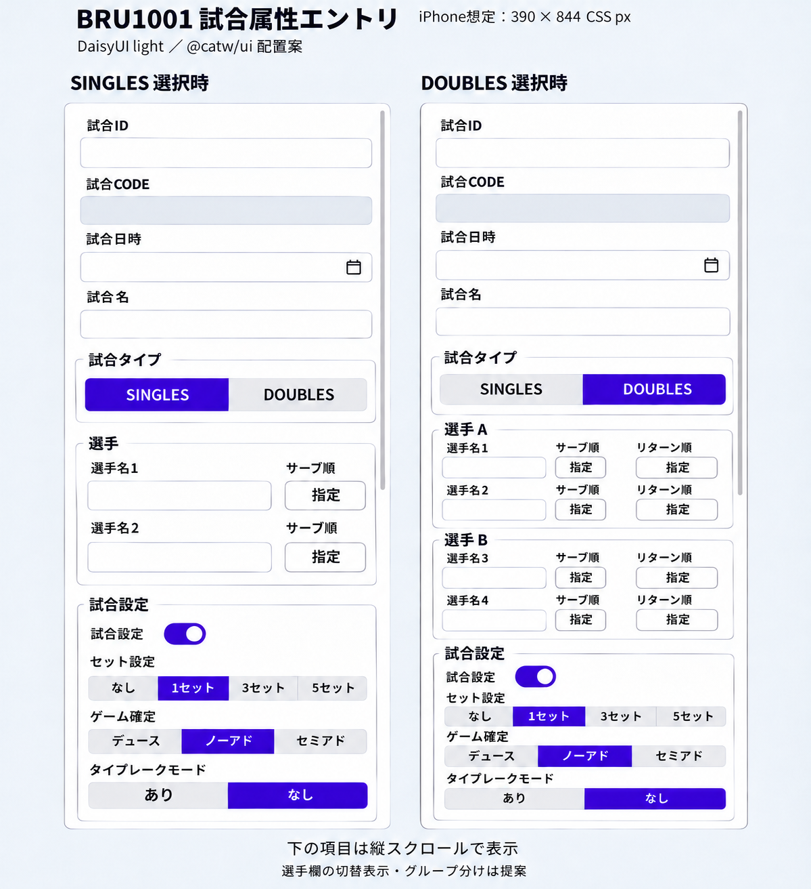

# 画面設計書
- 論理名：試合属性エントリ
- 物理名：Bru1001Component
- ファイル名：bru1001.component.ts

## １．概要
試合属性の新規登録、更新をおこなう。

## ２．画面イメージ

iPhoneの縦向き表示（390 × 844 CSS px）を想定した、DaisyUIの`light`テーマ・`@catw/ui`による配置イメージ。左はSINGLES選択時、右はDOUBLES選択時を示す。

上記の画像は画面の配置イメージとし、サーブ順・リターン順ボタンの操作・表示（アイコン仕様を含む）は「３．画面項目／（５）画面表示仕様」を正本とする。

## ３．画面項目
#### （１）DTO種別
- [x] UI Form DTO（class形式）

#### （２）DTO名称
- 論理名：試合属性
- 物理名：Bru1001Dto
- ファイル名：bru1001.dto.ts

#### （３）DTOパッケージ
io\github\soracity\bruce\brf1000\brf1001\ui\dto

#### （４）DTO項目定義
| No | DTO対象 | 論理名 | 物理名 | コンポーネント名 | 型 | Enum型 | 無効状態 | 文字種 | 形式 | 必須 | 必須(真偽) | 文字数(最小/最大) | 数値(最小/最大) | 正規表現 | デフォルト | ラベルキー | 備考 |
| --- | --- | --- | --- | --- | --- | --- | --- | --- | --- | --- | --- | --- | --- | --- | --- | --- | --- |
| 01 | - | 基本情報 | - | `app-group` | - | - | - | - | - | - | - | - | - | - | - | `Brf9010I18nLabelKeyBrf1001Enum.LBL_BASIC_INFO` | 承認済みラベルキー（Enum生成未反映） |
| 02 | 〇 | 試合ID | matchId | `app-textbox` | 文字列 | - | 〇 | - | - | - | - | - | - | - | - | `Brf9010I18nLabelKeyBrf1001Enum.LBL_MATCH_ID` | UUID |
| 03 | 〇 | 試合CODE | matchCode | `app-textbox` | 文字列 | - | 〇 | ASCII | 半角数字 | - | - | 6/6 | - | - | - | `Brf9010I18nLabelKeyBrf1001Enum.LBL_MATCH_CODE` | 先頭ゼロ埋め |
| 04 | 〇 | 試合日時 | matchDateTime | `app-date` | 文字列 | - | - | - | 日時 | - | - | - | - | - | - | `Brf9010I18nLabelKeyBrf1001Enum.LBL_MATCH_DATETIME` | UTC ISO 8601 |
| 05 | 〇 | 試合名 | matchName | `app-textbox` | 文字列 | - | - | Unicode | - | - | - | -/20 | - | - | - | `Brf9010I18nLabelKeyBrf1001Enum.LBL_MATCH_NAME` | - |
| 06 | - | 試合タイプ（グループ） | - | `app-group` | - | - | - | - | - | - | - | - | - | - | - | `Brf9010I18nLabelKeyBrf1001Enum.LBL_MATCH_TYPE` | 既存 |
| 07 | 〇 | 試合タイプ | matchType | `app-radio` | Enum | Brf9010CodeMatchTypeEnum | - | - | - | - | - | - | - | - | 0 | `Brf9010I18nLabelKeyBrf1001Enum.LBL_MATCH_TYPE` | SINGLES=0、DOUBLES=1 |
| 08 | - | 選手（シングルス） | - | `app-group` | - | - | - | - | - | - | - | - | - | - | - | `Brf9010I18nLabelKeyBrf1001Enum.LBL_PLAYERS` | 承認済みラベルキー（Enum生成未反映） |
| 09 | 〇 | 選手名１ | singlesPlayer1 | `app-textbox` | 文字列 | - | - | Unicode | - | - | - | -/20 | - | - | - | `Brf9010I18nLabelKeyBrf1001Enum.LBL_SINGLES_PLAYER1` | - |
| 10 | 〇 | 選手名２ | singlesPlayer2 | `app-textbox` | 文字列 | - | - | Unicode | - | - | - | -/20 | - | - | - | `Brf9010I18nLabelKeyBrf1001Enum.LBL_SINGLES_PLAYER2` | - |
| 11 | - | 選手A | - | `app-group` | - | - | - | - | - | - | - | - | - | - | - | `Brf9010I18nLabelKeyBrf1001Enum.LBL_PLAYER_A` | 承認済みラベルキー（Enum生成未反映） |
| 12 | - | サーブ順（選手A見出し） | - | `app-label` | - | - | - | - | - | - | - | - | - | - | - | `Brf9010I18nLabelKeyBrf1001Enum.LBL_SERVE_ROTATION` | 既存。現行HTMLは「サービス」 |
| 13 | - | リターン順（選手A見出し） | - | `app-label` | - | - | - | - | - | - | - | - | - | - | - | `Brf9010I18nLabelKeyBrf1001Enum.LBL_RETURN_ROTATION` | 既存。現行HTMLは「リターン」 |
| 14 | 〇 | 選手名１ | doublesPlayerA1 | `app-textbox` | 文字列 | - | - | Unicode | - | - | - | -/20 | - | - | - | `Brf9010I18nLabelKeyBrf1001Enum.LBL_DOUBLES_PLAYERA1` | - |
| 15 | 〇 | 選手名２ | doublesPlayerA2 | `app-textbox` | 文字列 | - | - | Unicode | - | - | - | -/20 | - | - | - | `Brf9010I18nLabelKeyBrf1001Enum.LBL_DOUBLES_PLAYERA2` | - |
| 16 | - | 選手B | - | `app-group` | - | - | - | - | - | - | - | - | - | - | - | `Brf9010I18nLabelKeyBrf1001Enum.LBL_PLAYER_B` | 承認済みラベルキー（Enum生成未反映） |
| 17 | - | サーブ順（選手B見出し） | - | `app-label` | - | - | - | - | - | - | - | - | - | - | - | `Brf9010I18nLabelKeyBrf1001Enum.LBL_SERVE_ROTATION` | 既存。現行HTMLは「サービス」 |
| 18 | - | リターン順（選手B見出し） | - | `app-label` | - | - | - | - | - | - | - | - | - | - | - | `Brf9010I18nLabelKeyBrf1001Enum.LBL_RETURN_ROTATION` | 既存。現行HTMLは「リターン」 |
| 19 | 〇 | 選手名３ | doublesPlayerB1 | `app-textbox` | 文字列 | - | - | Unicode | - | - | - | -/20 | - | - | - | `Brf9010I18nLabelKeyBrf1001Enum.LBL_DOUBLES_PLAYERB1` | - |
| 20 | 〇 | 選手名４ | doublesPlayerB2 | `app-textbox` | 文字列 | - | - | Unicode | - | - | - | -/20 | - | - | - | `Brf9010I18nLabelKeyBrf1001Enum.LBL_DOUBLES_PLAYERB2` | - |
| 21 | 〇 | サーブ順(選手名S1) | serveNoSinglesPlayer1 | `app-toggle` | 文字列 | - | - | - | - | - | - | - | - | - | - | `Brf9010I18nLabelKeyBrf1001Enum.LBL_SERVE_ROTATION` | - |
| 22 | 〇 | サーブ順(選手名S2) | serveNoSinglesPlayer2 | `app-toggle` | 文字列 | - | - | - | - | - | - | - | - | - | - | `Brf9010I18nLabelKeyBrf1001Enum.LBL_SERVE_ROTATION` | - |
| 23 | 〇 | サーブ順(選手名DA1) | serveNoDoublesPlayerA1 | `app-toggle` | 文字列 | - | - | - | - | - | - | - | - | - | - | `Brf9010I18nLabelKeyBrf1001Enum.LBL_SERVE_ROTATION` | - |
| 24 | 〇 | サーブ順(選手名DA2) | serveNoDoublesPlayerA2 | `app-toggle` | 文字列 | - | - | - | - | - | - | - | - | - | - | `Brf9010I18nLabelKeyBrf1001Enum.LBL_SERVE_ROTATION` | - |
| 25 | 〇 | サーブ順(選手名DB1) | serveNoDoublesPlayerB1 | `app-toggle` | 文字列 | - | - | - | - | - | - | - | - | - | - | `Brf9010I18nLabelKeyBrf1001Enum.LBL_SERVE_ROTATION` | - |
| 26 | 〇 | サーブ順(選手名DB2) | serveNoDoublesPlayerB2 | `app-toggle` | 文字列 | - | - | - | - | - | - | - | - | - | - | `Brf9010I18nLabelKeyBrf1001Enum.LBL_SERVE_ROTATION` | - |
| 27 | 〇 | リターン順(選手名DA1) | returnNoDoublesPlayerA1 | `app-toggle` | Enum | Brf9010CodeCourtSideEnum | - | - | - | - | - | - | - | - | - | `Brf9010I18nLabelKeyBrf1001Enum.LBL_RETURN_ROTATION` | DEUCE_SIDE=0、AD_SIDE=1 |
| 28 | 〇 | リターン順(選手名DA2) | returnNoDoublesPlayerA2 | `app-toggle` | Enum | Brf9010CodeCourtSideEnum | - | - | - | - | - | - | - | - | - | `Brf9010I18nLabelKeyBrf1001Enum.LBL_RETURN_ROTATION` | DEUCE_SIDE=0、AD_SIDE=1 |
| 29 | 〇 | リターン順(選手名DB1) | returnNoDoublesPlayerB1 | `app-toggle` | Enum | Brf9010CodeCourtSideEnum | - | - | - | - | - | - | - | - | - | `Brf9010I18nLabelKeyBrf1001Enum.LBL_RETURN_ROTATION` | DEUCE_SIDE=0、AD_SIDE=1 |
| 30 | 〇 | リターン順(選手名DB2) | returnNoDoublesPlayerB2 | `app-toggle` | Enum | Brf9010CodeCourtSideEnum | - | - | - | - | - | - | - | - | - | `Brf9010I18nLabelKeyBrf1001Enum.LBL_RETURN_ROTATION` | DEUCE_SIDE=0、AD_SIDE=1 |
| 31 | - | 試合設定（グループ） | - | `app-group` | - | - | - | - | - | - | - | - | - | - | - | `Brf9010I18nLabelKeyBrf1001Enum.LBL_MATCH_SETTING` | 既存 |
| 32 | 〇 | 試合設定 | matchSetting | `app-toggle` | Enum | CatwCommonCodeBooleanEnum | - | - | - | - | - | - | - | - | 1 | `Brf9010I18nLabelKeyBrf1001Enum.LBL_MATCH_SETTING` | FALSE=0、TRUE=1 |
| 33 | - | セット設定（グループ） | - | `app-group` | - | - | - | - | - | - | - | - | - | - | - | `Brf9010I18nLabelKeyBrf1001Enum.LBL_SET_TYPE` | 既存 |
| 34 | 〇 | セット設定 | setType | `app-radio` | Enum | Brf9010CodeNumberOfSetsEnum | - | - | - | - | - | - | - | - | 1 | `Brf9010I18nLabelKeyBrf1001Enum.LBL_SET_TYPE` | SET_NON=0、SET1=1、SET3=3、SET5=5 |
| 35 | - | ゲーム確定（グループ） | - | `app-group` | - | - | - | - | - | - | - | - | - | - | - | `Brf9010I18nLabelKeyBrf1001Enum.LBL_GAME_FINAL_TYPE` | 既存 |
| 36 | 〇 | ゲーム確定 | gameFinalType | `app-radio` | Enum | Brf9010CodeGameFinalEnum | - | - | - | - | - | - | - | - | 1 | `Brf9010I18nLabelKeyBrf1001Enum.LBL_GAME_FINAL_TYPE` | DEUCE=0、NO_AD=1、SEMI_AD=2 |
| 37 | - | タイブレークモード（グループ） | - | `app-group` | - | - | - | - | - | - | - | - | - | - | - | `Brf9010I18nLabelKeyBrf1001Enum.LBL_TIEBREAK_MODE` | 既存 |
| 38 | 〇 | タイブレークモード | tieBreakMode | `app-radio` | Enum | Brf9010CodeTieBreakEnum | - | - | - | - | - | - | - | - | 1 | `Brf9010I18nLabelKeyBrf1001Enum.LBL_TIEBREAK_MODE` | WITH_TB=0、NO_TB=1 |
| 39 | 〇 | 状態 | matchStatus | - | Enum | Brf9010CodeMatchStatusEnum | - | - | - | - | - | - | - | - | 00 | - | NOT_STARTED=00、IN_PROGRESS=01、FINISHED=02、FINAL=03 |
| 40 | 〇 | 作成日 | createDateTime | - | 文字列 | - | - | - | 日時 | - | - | - | - | - | - | - | UTC ISO 8601 |
| 41 | 〇 | 更新日 | updateDateTime | - | 文字列 | - | - | - | 日時 | - | - | - | - | - | - | - | UTC ISO 8601 |
| 42 | 〇 | 削除日 | deleteDateTime | - | 文字列 | - | - | - | 日時 | - | - | - | - | - | - | - | UTC ISO 8601 |

「DTO対象」が`〇`の行だけACGによるFormControl生成対象とする。`-`の行は表示専用コンポーネントであり、DTOのFormControlを生成しない。コンポーネント名は`@catw/ui`のHTMLタグ名を記載する。非表示の管理項目もDTO生成対象のため`〇`とする。

`LBL_BASIC_INFO`、`LBL_PLAYERS`、`LBL_PLAYER_A`、`LBL_PLAYER_B`は**承認済みのラベルキー定義**であり、生成済みEnum／翻訳データへの反映は別工程で実施する。現行HTMLの「選手 A／選手 B」「サービス／リターン」と、今回の画面イメージ上の「選手A／選手B」「サーブ順／リターン順」には表示文言の差があるため、コードの表示はまだ変更しない。グループ見出し「試合設定」は既存の`LBL_MATCH_SETTING`に対応し、「ゲーム確定」グループとは別に扱う。

##### 型・形式
- 文字列：`string`
- 数値：`number`
- 真偽：`boolean`
- Enum：`Enum型`列で指定した既存自動生成Enum
- 日付・日時は型ではなく、文字列型の`形式`として指定する。

#### （５）画面表示仕様

##### 選手グループの配置

- 各選手を1行とし、DOUBLESでは左から「選手名」「サーブ順」「リターン順」、SINGLESでは「選手名」「サーブ順」の順に配置する。
- 選手名の入力欄を広めに取り、サーブ順とリターン順のボタンは同じ幅・高さにそろえる。
- 同じ行の入力欄とボタンの上辺・下辺をそろえ、列間の余白と各行の間隔を統一する。
- 選手A・選手Bの両グループで列位置・列幅・内側の余白をそろえる。
- DOUBLESでは列幅を選手名60、サーブ順20、リターン順20の比率とし、選手A・選手Bの各グループ先頭に「サービス」「リターン」の列見出しを一度だけ表示する。見出しは各ボタンの中央に揃え、選手名列には見出しを置かない。

##### サーブ順ボタン

- サーブ順はテキスト入力ではなく、各選手の行に配置するボタンで指定する。
- サーブ順ボタンには、文字列の「指定」や数字の文字を表示せず、状態に対応する**アイコンのみ**を表示する。
- アイコンの描画は`catw-icons`を使用する。未指定にはカスタムSVG、指定済みにはGoogle Material Symbolsを使用する。

| DTOに保持するサーブ順 | ボタンに表示するアイコン | アイコンの種類 |
| --- | --- | --- |
| 未指定（空文字・未設定） | `soracity-common-ellipsis`（…） | `catw-icons`のカスタムSVG |
| `"1"` | `counter_1` | Google Material Symbols |
| `"2"` | `counter_2` | Google Material Symbols |
| `"3"` | `counter_3` | Google Material Symbols |
| `"4"` | `counter_4` | Google Material Symbols |

| 試合タイプ | 対象のDTO項目 | 順序の割り当て |
| --- | --- | --- |
| SINGLES | `serveNoSinglesPlayer1`、`serveNoSinglesPlayer2` | 2名に対して1～2 |
| DOUBLES | `serveNoDoublesPlayerA1`、`serveNoDoublesPlayerA2`、`serveNoDoublesPlayerB1`、`serveNoDoublesPlayerB2` | A・Bの各ペアに1・3または2・4を割り当てる |

###### SINGLESのボタン操作

- 未指定の選手を押すと、指定済み人数に1を加えたサーブ順（1～2）をその選手へ設定する。全員未指定なら1から始める。
- 指定済みの選手を押すと、その選手の順序を解除する。解除した番号より後の番号は1つ繰り上げ、1からの連番を維持する。
- 設定・解除のたびに対応するDTOの文字列値とアイコンを更新する。未指定の表示は`soracity-common-ellipsis`に戻す。

###### DOUBLESのボタン操作

- 選手AはA1・A2、選手BはB1・B2の**ペア単位**でサーブ順を設定・解除する。一人ずつ連番を付ける方式は使用しない。
- **そのペアが未指定の選手をタップした場合：** 押した選手に番号を割り当て、同じペアのパートナーにも番号を自動設定する。
  - 反対側のペアが未指定、または2・4を使用中なら、押した選手に**1**、パートナーに**3**を割り当てる。
  - 反対側のペアが1・3を使用中なら、押した選手に**2**、パートナーに**4**を割り当てる。
  - A/Bのどちらのペアが1・3を使用するかは固定しない。**全員未指定の状態では、最初にタップされたペアが1・3となる。**
- **そのペアが設定済みの選手をタップした場合：** 押した選手とパートナーのサーブ順を**両方とも解除**して未指定にする。反対側のペアの設定値は変更しない。
- ペアの解除によって、反対側の番号を繰り上げたり振り直したりしない。片方のペアだけ設定済みの場合、1・3または2・4の欠番を許容する。
- タップごとにA1・A2・B1・B2の対応するDTO文字列値とアイコンを更新する。

###### DOUBLESの操作例

未指定を「…」で表す。各行は**直前の状態からの連続操作**である。

| 操作 | ダブルスA1 | ダブルスA2 | ダブルスB1 | ダブルスB2 |
| --- | ---: | ---: | ---: | ---: |
| 初期状態 | … | … | … | … |
| ① A1をタップ | 1 | 3 | … | … |
| ② B1をタップ | 1 | 3 | 2 | 4 |
| ③ A1を再タップ | … | … | 2 | 4 |
| ④ A2をタップ | 3 | 1 | 2 | 4 |
| ⑤ B1を再タップ | 3 | 1 | … | … |
| ⑥ A2を再タップ | … | … | … | … |
| ⑦ B2をタップ | … | … | 3 | 1 |
| ⑧ A1をタップ | 2 | 4 | 3 | 1 |

この表の数字はDTOに保持するサーブ順を示す。実画面では上記のアイコン対応表に従い、`counter_1`～`counter_4`で表示する。

##### リターン順ボタン

- DOUBLESの各選手の行に、リターン順を切り替えるボタンを1つ表示する。
- SINGLESではリターン順ボタンを表示しない。

| 選手 | 対象のDTO項目 |
| --- | --- |
| 選手1（A1） | `returnNoDoublesPlayerA1` |
| 選手2（A2） | `returnNoDoublesPlayerA2` |
| 選手3（B1） | `returnNoDoublesPlayerB1` |
| 選手4（B2） | `returnNoDoublesPlayerB2` |

###### 初期表示

- サーブ順と同じ`@catw/ui`の`<app-toggle>`（BUTTON型、`iconOnly=true`）を使用し、**アイコンのみ**を表示する。ボタン内に「指定」「デュース」「アド」の文字は出さない。
- 未指定は`soracity-common-ellipsis`、デュース・アドは案2のD/Aを枠で囲った`catw-icons`のテニスSVGを使用する。
- 表示名はアクセシビリティ用の`aria-label`として維持し、値が指定されているときはToggleの選択状態を有効にする。

| DTO項目の現在値 | 表示アイコン | アクセシビリティ名 |
| --- | --- | --- |
| 未指定（null） | `soracity-common-ellipsis`（…） | リターン位置：未指定 |
| `Brf9010CodeCourtSideEnum.DEUCE_SIDE`（コード値0） | `soracity-tennis-return-deuce`（枠付きD） | リターン位置：デュースサイド |
| `Brf9010CodeCourtSideEnum.AD_SIDE`（コード値1） | `soracity-tennis-return-ad`（枠付きA） | リターン位置：アドサイド |

###### ボタンを押した場合

1. 押した選手に対応するDTO項目の現在値に応じて、次のEnumを設定する。
2. 同じペアのパートナーに、押した選手とは反対側のEnumを自動設定する（デュースならアド、アドならデュース）。
3. 押した選手とパートナーの両方のDTO値・Toggleアイコンを更新する。A1・A2の操作はB1・B2に影響せず、B1・B2の操作もA1・A2に影響しない。

| 押下前の状態・アイコン | 押下後に設定するEnum | 押下後のアイコン |
| --- | --- | --- |
| 未指定（…） | `Brf9010CodeCourtSideEnum.DEUCE_SIDE` | 枠付きD |
| デュース（D） | `Brf9010CodeCourtSideEnum.AD_SIDE` | 枠付きA |
| アド（A） | `Brf9010CodeCourtSideEnum.DEUCE_SIDE` | 枠付きD |

未指定時は最初の押下でデュースを設定する。その後は押すたびに「デュース ⇄ アド」を切り替え、ボタン押下では未指定に戻さない。

- A1・A2、B1・B2をそれぞれ1組とし、片方がデュースならパートナーは必ずアドにする。
- A1を未指定から押した場合はA1＝デュース、A2＝アド。続けてA1を押した場合はA1＝アド、A2＝デュースとなる。A2から押した場合も同じ規則でA2＝デュース、A1＝アドとする。
- Bペアも同じ規則で動作するが、AペアとBペアの設定は独立させる。
