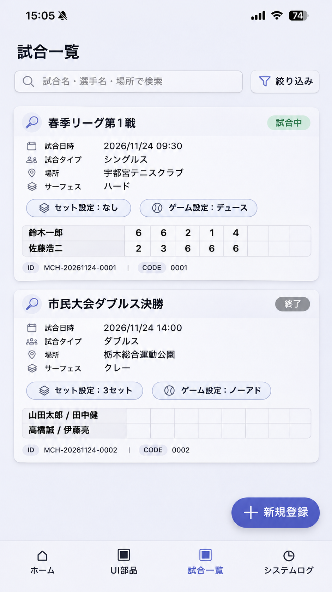

# 画面設計書
- 論理名：スコア
- 物理名：Bru1002ScoreComponent
- ファイル名：bru1002-score.component.ts

## １．概要
試合属性の一覧を取得し、各試合をカード形式で表示する。

- 1試合を1カードとして縦方向に並べる。
- カードに表示する属性は、試合名・試合日時・試合タイプ・選手名・試合状態・場所・サーフェス・セット設定・ゲーム確定の**9種類**とする。
- ポイント／スコアをカード内の2行の表で表示する。セット設定の有無により表示内容を切り替える。
- 画面構成・表示項目の確定事項と、画像例・未確定の操作仕様を区別する。

## ２．画面イメージ

- 表示形式：iPhone等の**実機の縦横比に近い縦長のスマートフォン画面**を前提とする。画面幅で閲覧できるカード形式とする。
- カードの並び：1試合につき1カードを縦方向に配置する。
- 画面のカードイメージ：画面上部に「試合一覧」、カードの先頭に試合名・試合状態、続いて試合日時・試合タイプ・場所・サーフェス・選手名、次にポイント／スコア表、カード下部に「セット設定」「ゲーム確定」の表示を置いた**検討中の配置案**。
- カードの色・影・角丸、状態別バッジ、テニス等のアイコン、検索欄・フィルタ・新規試合ボタンの外観は、会話で作成した画像イメージを参照するが、詳細デザイン・動作は未確定。
- 画像に使った日付・試合名・場所名・選手名・状態・スコア値は例示であり、固定値や実データではない。
- **画像例にあった試合タイプと選手名／スコア表の不一致（シングルス表記でダブルスのペア名を表示する等）は仕様に採用しない。**
- 上記の画像はレイアウト・外観の参照用とする。表示例の日時・試合名・選手名・スコア等はサンプルデータであり、確定仕様は本設計書の記載に従う。

## ３．画面項目
#### （１）DTO種別
- [x] 型形式(ブランド有)

#### （２）DTO名称
- 論理名：スコア
- 物理名：Bru1002ScoreDto
- ファイル名：bru1002-score.dto.ts

#### （３）DTOパッケージ
io\github\soracity\bruce\brf1000\brf1002\ui\dto

#### （４）DTO項目定義
| No | DTO対象 | 論理名 | 物理名 | コンポーネント名 | アイコン  | 型 | Enum型 | 無効状態 | 文字種 | 形式 | 必須 | 必須(真偽) | 文字数(最小/最大) | 数値(最小/最大) | 正規表現 | デフォルト | ラベルキー | データ | データ編集 | 備考 |
| --- | --- | --- | --- | --- | --- | --- | --- | --- | --- | --- | --- | --- | --- | --- | --- | --- | --- | --- | --- | --- |
| 1 | 〇 | No | searchItem | app-table | - | 文字列 | - | - | - | - | - | - | - | - | - | - | - | - | - | - |
| 2 | 〇 | team1 | search | app-table | - | 文字列 | - | - | - | - | - | - | - | - | - | - | - | - | - | - |
| 3 | 〇 | team2 | matchName | app-table | - | 文字列 | - | - | - | - | - | - | - | - | - | - | - |  | - | - |

##### 型・形式
- 文字列：`string`
- 数値：`number`
- 真偽：`boolean`
- Enum：`Enum型`列で指定した既存自動生成Enum
- 日付・日時は型ではなく、文字列型の`形式`として指定する。

