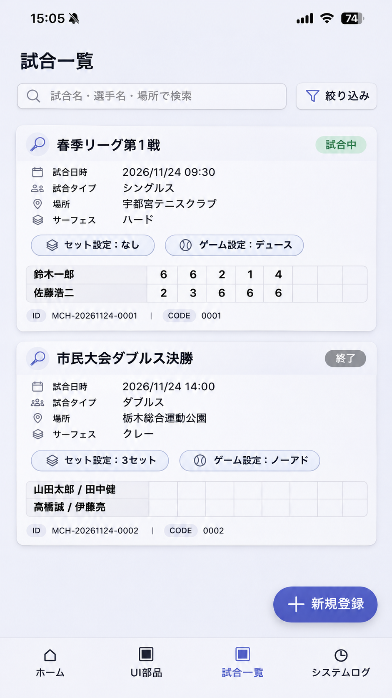

# 画面設計書
- 論理名：試合属性一覧
- 物理名：Bru1002Component
- ファイル名：bru1002.component.ts

## １．概要
試合属性の一覧を取得し、各試合をカード形式で表示する。

- 1試合を1カードとして縦方向に並べる。
- カードに表示する属性は、試合名・試合日時・試合タイプ・選手名・試合状態・場所・サーフェス・セット設定・ゲーム確定の**9種類**とする。
- ポイント／スコアをカード内の2行の表で表示する。セット設定の有無により表示内容を切り替える。
- 画面構成・表示項目の確定事項と、画像例・未確定の操作仕様を区別する。

## ２．画面イメージ

- 表示形式：iPhone等の**実機の縦横比に近い縦長のスマートフォン画面**を前提とする。画面幅で閲覧できるカード形式とする。
- カードの並び：1試合につき1カードを縦方向に配置する。
- 画面のカードイメージ：画面上部に「試合一覧」、カードの先頭に試合名・試合状態、続いて試合日時・試合タイプ・場所・サーフェス・選手名、次にポイント／スコア表、カード下部に「セット設定」「ゲーム確定」の表示を置いた**検討中の配置案**。
- カードの色・影・角丸、状態別バッジ、テニス等のアイコン、検索欄・フィルタ・新規試合ボタンの外観は、会話で作成した画像イメージを参照するが、詳細デザイン・動作は未確定。
- 画像に使った日付・試合名・場所名・選手名・状態・スコア値は例示であり、固定値や実データではない。
- **画像例にあった試合タイプと選手名／スコア表の不一致（シングルス表記でダブルスのペア名を表示する等）は仕様に採用しない。**
- 上記の画像はレイアウト・外観の参照用とする。表示例の日時・試合名・選手名・スコア等はサンプルデータであり、確定仕様は本設計書の記載に従う。

## ３．画面項目
#### （１）DTO種別
- [x] 型形式(ブランド有)

#### （２）DTO名称
- 論理名：試合属性
- 物理名：Bru1002Dto
- ファイル名：bru1002.dto.ts

#### （３）DTOパッケージ
io\github\soracity\bruce\brf1000\brf1002\ui\dto

#### （４）DTO項目定義
| No | DTO対象 | 論理名    | 物理名             | コンポーネント名          | 型    | Enum型                       | 無効状態 | 文字種 | 形式 | 必須 | 必須(真偽) | 文字数(最小/最大) | 数値(最小/最大) | 正規表現 | デフォルト | ラベルキー | データ                           | データ編集            | 備考                                                 |
| --- | --- | --- | --- | --- | --- | --- | --- | --- | --- | --- | --- | --- | --- | --- | --- | --- | --- | --- | --- |
| 1  | -     | 検索項目   | searchItem      | app-textbox       | 文字列  | -                           | -    | -   | -  | -  | -      | -          | -         | -    | -     | 未定義（候補：Brf9010I18nLabelKeyBrf1002Enum.LBL_SEARCH_ITEM） | -                             | -                | -                                                  |
| 2  | -     | 検索     | search          | app-button        | -    | -                           | -    | -   | -  | -  | -      | -          | -         | -    | -     | 未定義（候補：Brf9010I18nLabelKeyBrf1002Enum.LBL_SEARCH） | -                             | -                | -                                                  |
| 3  | 〇     | 試合名    | matchName       | app-group         | 文字列  | -                           | -    | -   | -  | -  | -      | -          | -         | -    | -     | Brf9010I18nLabelKeyBrf1002Enum.LBL_MATCH_NAME | t_t_matches.match_name        | -                | -                                                  |
| 4  | 〇     | 状態     | matchStatus     | app-badge         | Enum | Brf9010CodeMatchStatusEnum  | -    | -   | -  | -  | -      | -          | -         | -    | -     | Brf9010I18nLabelKeyBrf1002Enum.LBL_MATCH_STATUS | t_t_matches.match_status      | -                | NOT_STARTED=00、IN_PROGRESS=01、FINISHED=02、FINAL=03 |
| 5  | 〇     | 試合日時   | matchDateTime   | app-display-field | 文字列  | -                           | -    | -   | -  | -  | -      | -          | -         | -    | -     | Brf9010I18nLabelKeyBrf1002Enum.LBL_MATCH_DATETIME | t_t_matches.match_date_time   | YYYY/MM/DD HH:MM | -                                                  |
| 6  | 〇     | 試合タイプ  | matchType       | app-display-field | Enum | Brf9010CodeMatchTypeEnum    | -    | -   | -  | -  | -      | -          | -         | -    | -     | Brf9010I18nLabelKeyBrf1002Enum.LBL_MATCH_TYPE | t_t_matches.match_type        | -                | SINGLES=0、DOUBLES=1                                |
| 7  | 〇     | 場所     | matchPlace      | app-display-field | 文字列  | -                           | -    | -   | -  | -  | -      | -          | -         | -    | -     | 未定義（候補：Brf9010I18nLabelKeyBrf1002Enum.LBL_MATCH_PLACE） | t_t_matches.matchPlace        | -                | -                                                  |
| 8  | 〇     | サーフェス  | surface         | app-display-field | 文字列  | -                           | -    | -   | -  | -  | -      | -          | -         | -    | -     | 未定義（候補：Brf9010I18nLabelKeyBrf1002Enum.LBL_SURFACE） | t_t_matches.surface           | -                | -                                                  |
| 9  | 〇     | セット設定  | setType         | app-badge         | Enum | Brf9010CodeNumberOfSetsEnum | -    | -   | -  | -  | -      | -          | -         | -    | -     | Brf9010I18nLabelKeyBrf1002Enum.LBL_SET_TYPE | t_t_matches.set_type          | -                | SET_NON=0、SET1=1、SET3=3、SET5=5                     |
| 10 | 〇     | ゲーム確定  | gameFinalType   | app-badge         | Enum | Brf9010CodeGameFinalEnum    | -    | -   | -  | -  | -      | -          | -         | -    | -     | Brf9010I18nLabelKeyBrf1002Enum.LBL_GAME_FINAL_TYPE | t_t_matches.game_final_type   | -                | DEUCE=0、NO_AD=1、SEMI_AD=2                          |
| 11 | 〇     | 選手名１   | singlesPlayer1  | app-table         | 文字列  | -                           | -    | -   | -  | -  | -      | -          | -         | -    | -     | Brf9010I18nLabelKeyBrf1002Enum.LBL_SINGLES_PLAYER1 | t_t_matches.singles_player1   | -                | -                                                  |
| 12 | 〇     | 選手名２   | singlesPlayer2  | app-table         | 文字列  | -                           | -    | -   | -  | -  | -      | -          | -         | -    | -     | Brf9010I18nLabelKeyBrf1002Enum.LBL_SINGLES_PLAYER2 | t_t_matches.singles_player2   | -                | -                                                  |
| 13 | 〇     | 選手名１   | doublesPlayerA1 | app-table         | 文字列  | -                           | -    | -   | -  | -  | -      | -          | -         | -    | -     | Brf9010I18nLabelKeyBrf1002Enum.LBL_DOUBLES_PLAYERA1 | t_t_matches.doubles_player_a1 | -                | -                                                  |
| 14 | 〇     | 選手名２   | doublesPlayerA2 | app-table         | 文字列  | -                           | -    | -   | -  | -  | -      | -          | -         | -    | -     | Brf9010I18nLabelKeyBrf1002Enum.LBL_DOUBLES_PLAYERA2 | t_t_matches.doubles_player_a2 | -                | -                                                  |
| 15 | 〇     | 選手名３   | doublesPlayerB1 | app-table         | 文字列  | -                           | -    | -   | -  | -  | -      | -          | -         | -    | -     | Brf9010I18nLabelKeyBrf1002Enum.LBL_DOUBLES_PLAYERB1 | t_t_matches.doubles_player_b1 | -                | -                                                  |
| 16 | 〇     | 選手名４   | doublesPlayerB2 | app-table         | 文字列  | -                           | -    | -   | -  | -  | -      | -          | -         | -    | -     | Brf9010I18nLabelKeyBrf1002Enum.LBL_DOUBLES_PLAYERB2 | t_t_matches.doubles_player_b2 | -                | -                                                  |
| 17 | 〇     | 試合ID   | matchId         | app-display-field | 文字列  | -                           | -    | -   | -  | -  | -      | -          | -         | -    | -     | Brf9010I18nLabelKeyBrf1002Enum.LBL_MATCH_ID | t_t_matches.match_id          | -                | UUID                                               |
| 18 | 〇     | 試合CODE | matchCode       | app-display-field | 文字列  | -                           | -    | -   | -  | -  | -      | -          | -         | -    | -     | Brf9010I18nLabelKeyBrf1002Enum.LBL_MATCH_CODE | t_t_matches.match_code        | -                | 先頭ゼロ埋め                                             |

##### 型・形式
- 文字列：`string`
- 数値：`number`
- 真偽：`boolean`
- Enum：`Enum型`列で指定した既存自動生成Enum
- 日付・日時は型ではなく、文字列型の`形式`として指定する。

## ４．イベント
| No | 操作対象 | 操作・イベント | 現在確認できる事項 |
|---|---|---|---|
| 01 | 初期表示 | 試合一覧表示 | 試合属性データを取得して画面に表示する。 |
| 02 | FAB押下時 | 新規試合の登録を開始する | FAB押下でbru1001へ新規モードで遷移。 |
| 03 | 試合カードスワイプ時 | スワイプ | スワイプメニューの編集ボタン押下でbru1001へ編集モードで遷移。 |
| 04 | 試合カード | スワイプ | スワイプメニューの削除ボタン押下で試合属性削除。 |
| 05 | 試合カード | 試合を選択する | ポイント入力画面に遷移する。 |
| 06 | 検索・絞り込み | 検索欄・フィルタの操作 | 検索条件に従い、試合属性データを再取得して画面に表示する。 |

#### （１） 初期表示
- 試合一覧表示する。
- 試合属性データを取得して画面に表示する。

#### （２） FAB押下
- FAB押下でbru1001へ新規モードで遷移。

#### （３） 試合カードスワイプ時（編集）
- スワイプメニューの編集ボタン押下でbru1001へ編集モードで遷移。

#### （４） 試合カードスワイプ時（削除）
- スワイプメニューの削除ボタン押下で試合属性削除。

#### （５） 試合カード選択
- ポイント入力画面に遷移する。

#### （６） 検索ボタン押下
- 検索条件に従い、試合属性データを再取得して画面に表示する。
